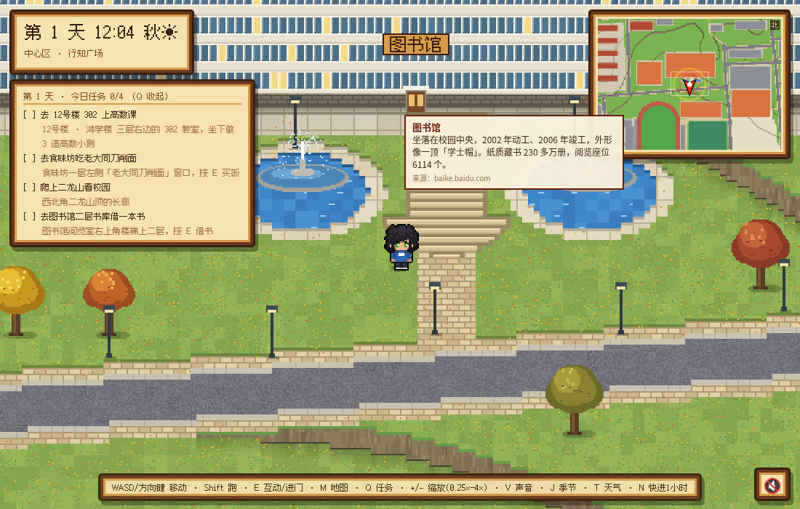

# 中北大学 · 像素校园漫步 (nuc-campus) v7.9.5

一个俯视角(3/4 视角)像素风的中北大学(太原)校园漫步游戏。纯静态 HTML5 Canvas,无构建步骤、无运行时依赖。



## 功能概览
- **真实布局**:校园道路、建筑轮廓、水系、绿地取自 OpenStreetMap,比例 2.5 m / 格(1 格 = 16 px),地图 755×514 格。覆盖西区、中心区、东区、北区、南区 · 德怀广场、二龙山、汾河沿岸。
- **真实地形**:SRTM 等高程数据(Terrarium 瓦片)生成台地分层、挡土墙、坡道和台阶。
- **可进入的室内**:主楼(含 2F 校史展廊)、图书馆(含 2F)、鸿学楼 301/302 教室、文瀛苑9号公寓 413 宿舍、体育馆、文瀛食堂 / 食味坊 / 田园餐厅 / 龙山餐厅等(多层,楼梯相连)。
- **作息与 NPC**:按中北大学冬令时 / 夏令时作息打铃;学生按时段在教学楼、食堂、宿舍、图书馆之间流动;23:00 熄灯;06:00–07:00 教官大队在行知广场训练,07:00 升旗护卫队出旗,07:05 旗帜升到顶。
- **季节与天气**:按真实日期自动换季(春夏秋冬树木、积雪),晴 / 雨 / 雪。
- **任务与小测**:每日任务、鸿学楼 302 高数小测。
- **悬停介绍**:鼠标移到建筑或地标上显示 1–3 句介绍,共 137 处,其中 71 处有出处,其余标注「未核实」。
- **v7.7 地图编辑器（管理员专用）**:`game/editor.html`,画笔 / 直线 / 矩形 / 橡皮 / 吸管、碰撞开关、抬高降低台地、移动缩放删除建筑和门、一键拉直台阶、撤销重做、检查、导出导入。**不随公开站点发布**,只在本地 `npm run admin` 里用,详见 [docs/MAP_EDITOR.md](docs/MAP_EDITOR.md)。
- **v7.7 二龙山成就**:山门、一人亭、石碑三处打卡和登顶,解锁时弹出提示,K 打开成就面板。
- **v7.7 共享电单车**:16 个停车点(位置未核实),B 上车 / 还车,只能在路上骑,部分学生也骑车。
- **v7.9.1 操作模式**：菜单可切换「自动 / 电脑 / 触屏」，统一探测模块 `input_mode.js`，支持键鼠混合；桌面 e2e 回归。
- **v7.9.2 手机视野**：手机上默认 1×（390 宽从 12 格变 24 格），相机把人物放低一点多看到前方的路，横屏收起任务地点说明；桌面和平板仍是 2×。
- **v7.9.3 角落堆叠 HUD**：时钟、今日任务、提示、成就卡排在左上角一列，小地图单独右上角，靠文档流排不靠手写偏移，任何屏幕都不会互相压；手机人物固定在屏幕下半部分，任务面板默认收成一行标题。
- **v7.9.4 桌面不再出摇杆**：触屏笔记本的 `any-pointer: coarse` 之前被当成触屏，导致桌面上冒出摇杆；现在只认主指针，鼠标为主就按电脑模式走。菜单里仍可手动切「自动 / 电脑 / 触屏」。
- **v7.9.5 新生向文案**：137 处地点介绍统一成「名称/编号 → 位置 → 用途或事实」的书面口径，去掉口语与传闻；没有可靠来源的照旧标「未核实」，不编内容。
- **v7.9 管理员发布**：本地 `npm run admin` 一键写入 `game/data`；或配置 fine-grained PAT「发布到 GitHub」。详见 [docs/ADMIN_PUBLISH.md](docs/ADMIN_PUBLISH.md)。
- **v7.9 手机适配**：情境主按钮、底部抽屉菜单、刘海安全区、拍照快门与 iOS 分享保存、DPR≤2；详见 [docs/MOBILE_AUDIT.md](docs/MOBILE_AUDIT.md)。
- **v7.8 沉浸 / 拍照 / 备份 / 地标**：Z 沉浸模式、P 拍照（带本游戏水印）、Y 地标传送、存档导出导入、门口名牌；UX 灵感来自同事 PixelCampus（仅学想法，未复制代码，见 [docs/LEARNED_FROM_PIXELCAMPUS.md](docs/LEARNED_FROM_PIXELCAMPUS.md)）。
- **v7.7 手机操作**:虚拟摇杆、触屏按钮、轻点查看介绍,竖屏横屏都能玩。
- **音效**:脚步、上下课铃、鸟鸣 / 虫鸣 / 雨声(均为 CC0)。存档保存在浏览器 localStorage。

## 本地运行
游戏需要通过 HTTP 打开(`file://` 下 `fetch` 不可用):
```bash
cd game && python3 -m http.server 8090
```
浏览器打开 http://localhost:8090/ 。全部资源都在本地,断网可玩。没有 Python 也可用 `npx serve -l 8090 .`(在 game/ 目录下)。地图编辑器不在公开站点上,需要改图时在仓库根目录运行 `npm run admin`,用终端打印的地址打开。

## 操作
| 按键 | 作用 |
|---|---|
| WASD / 方向键 | 行走 |
| Shift | 跑 |
| E / 空格 / 回车 | 进门、和学生交谈、查看牌子或雕像 |
| M | 全图(点击传送) |
| + / − / 鼠标滚轮 | 缩放(0.25×、0.5×、1–4×) |
| Q | 显示 / 隐藏任务面板 |
| V | 静音 / 取消静音 |
| N | 时间快进 1 小时 |
| J | 切换季节:自动 → 春 → 夏 → 秋 → 冬 |
| T | 切换天气:自动 → 晴 → 雨 → 雪 |
| 1–4 | 回答 302 高数小测 |
| B | 在停车点骑上 / 归还共享电单车 |
| K | 成就面板 |
| Z | 沉浸模式（隐藏界面） |
| P | 拍照模式 |
| Y | 地标传送清单 |
| Tab | 菜单 |
| Esc | 关闭地图或对话框 |

触屏(v7.7):左下角摇杆行走,双指捏合缩放,右侧圆形 **E** 按钮交互、「骑车」按钮上下车、☰ 打开菜单;轻点建筑查看介绍。走到门口的门垫格子即可离开室内。

调试用 URL 参数(节选):`x`、`y`(起点格坐标)、`zoom`、`t`(分钟,如 `t=1290` 即 21:30)、`interior=main|library|canteen|classroom|dorm|gym…`、`season=`、`weather=`、`bells=summer|winter`、`nosave`、`reset`、`mute`。带 `x`/`y`/`t`/`interior`/`nosave` 时不读写存档。完整列表见 [docs/CHANGELOG_full_en.md](docs/CHANGELOG_full_en.md) 的 “Controls” 一节。

## 测试
需要 Node.js ≥ 22(使用内置 `node:test`,无第三方依赖):
```bash
npm test            # 仓库根目录;等价于 cd game && npm test
```
当前结果:166 个测试,162 通过,0 失败,4 跳过(v7.3 南侧大台阶已在 v7.6.4 中移除,对应用例跳过)。

## 目录结构
```
game/            可直接部署的静态游戏(index.html、js/、data/、assets/、audio/、tests/)
tools/           地图生成管线(build_map.py + layout_v*.py 等)、角色精灵生成、e2e 脚本
data/            构建输入:OSM 原始数据、DEM 高程瓦片、手绘补充数据(不含卫星图)
docs/            说明文档、命名依据、作息依据、完整英文更新日志、截图
.github/workflows/pages.yml   可选:GitHub Pages 自动部署 game/
```

## 文档
- [docs/HOW_IT_WAS_MADE.md](docs/HOW_IT_WAS_MADE.md):制作方法、数据来源、管线、版本历史、未核实清单
- [docs/UPLOAD_TO_GITHUB.md](docs/UPLOAD_TO_GITHUB.md)(副本:`上传到GitHub说明.md`):上传到 GitHub 的步骤
- [ATTRIBUTION.md](ATTRIBUTION.md)、[CREDITS.md](CREDITS.md):数据与素材署名、许可
- [docs/NAMES.md](docs/NAMES.md)、[docs/V7_SOURCES.md](docs/V7_SOURCES.md)、[docs/bell_times.md](docs/bell_times.md)、[game/data/canteens_sources.md](game/data/canteens_sources.md):命名、作息、食堂的出处

## 许可
- 代码:MIT,见 [LICENSE](LICENSE)。
- 地图数据:© OpenStreetMap contributors,ODbL 1.0;高程数据署名见 [ATTRIBUTION.md](ATTRIBUTION.md)。
- 字体 OFL 1.1;角色精灵与音效 CC0。
- 「中北大学」校名及相关标识归中北大学所有;本项目为非官方作品,与中北大学无隶属关系。
